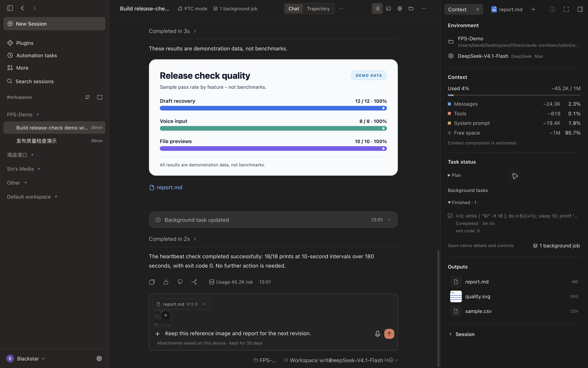
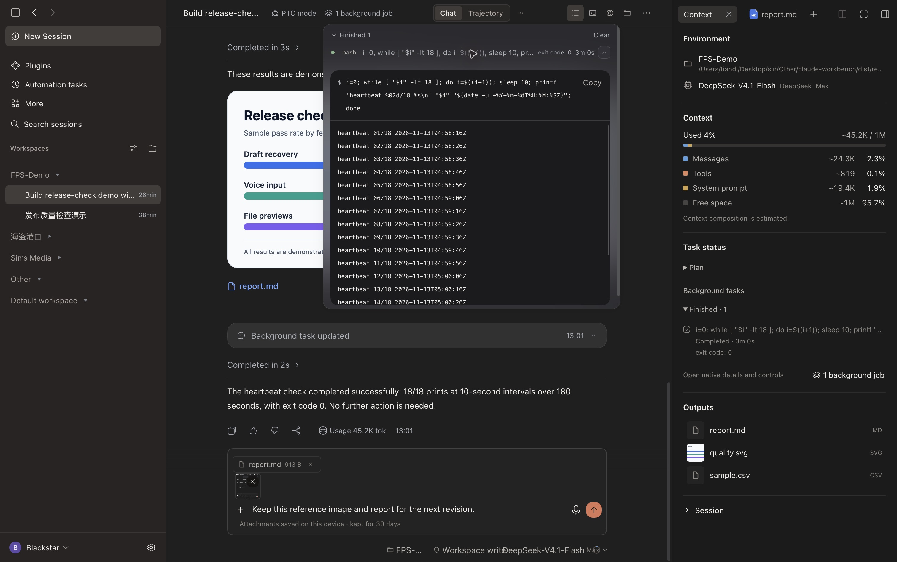
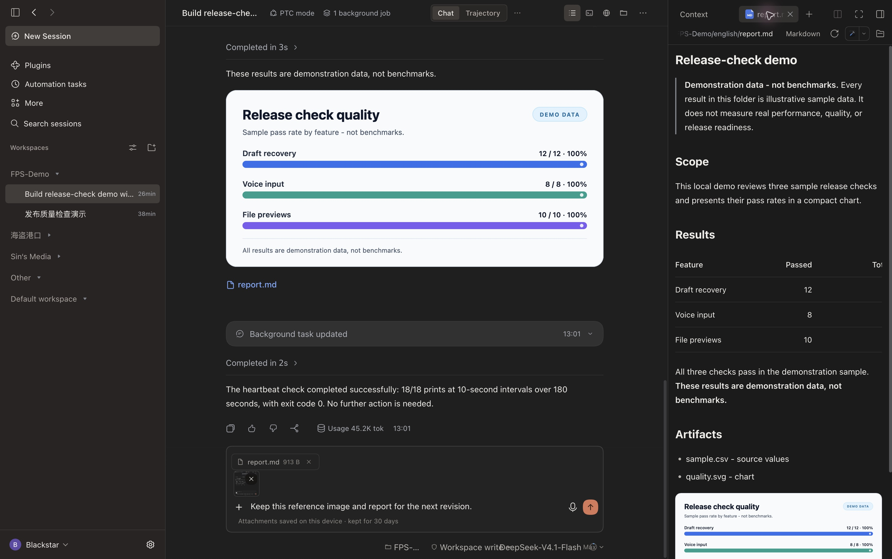
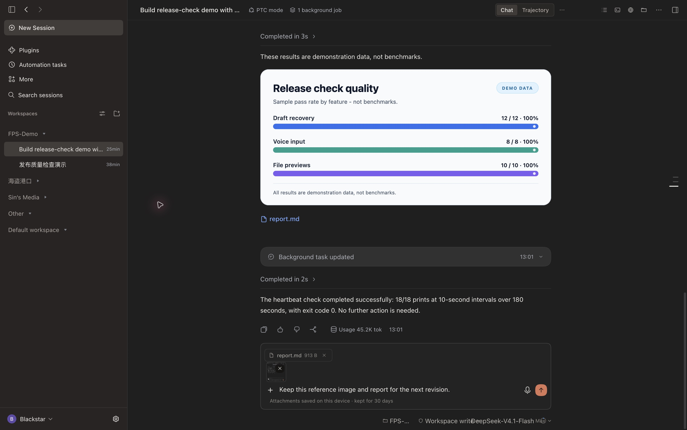
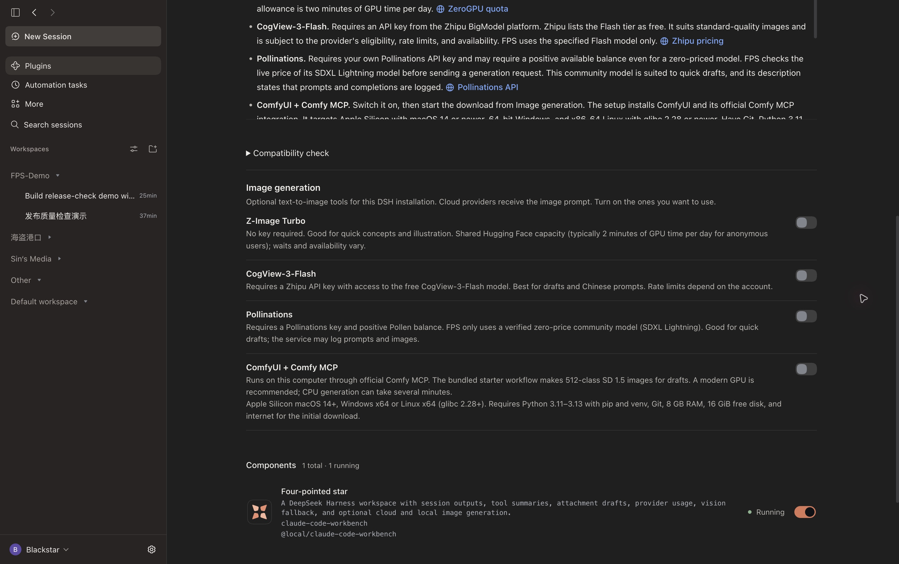
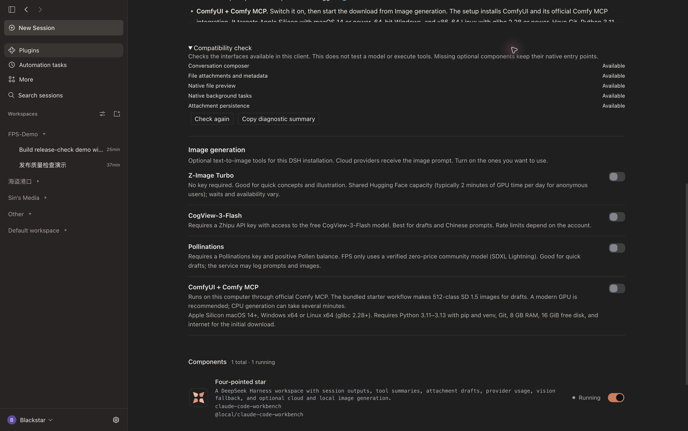

# Four-pointed star (FPS)

[GitHub repository](https://github.com/Blacstar7/dsh-fps-workbench) · [Plugin catalog](https://awesome-dsh-plugin.com/p/Blacstar7/dsh-fps-workbench/) · [Changelog](https://github.com/Blacstar7/dsh-fps-workbench/blob/main/CHANGELOG.md) · [npm](https://www.npmjs.com/package/dsh-fps-workbench)

**Follow the work. Keep the draft. Find the result.**

[简体中文](README.zh.md) · [Install](#install) · [Changelog](CHANGELOG.md) · [Detailed guide](locale/detail.en.md)

FPS is a conversation workbench for **DeepSeek Harness (DSH)**. It brings tool summaries, long-task status, session outputs, recoverable attachment drafts, and provider usage into the conversation. A quiet interface in light and dark mode helps you follow an agent from the first instruction to the finished files.

DSH continues to own sessions, tool execution, permissions, voice transcription, and file previews. FPS makes that work easier to follow and adds practical tools around it.



> Captured fullscreen in dark mode with the left sidebar expanded in DSH Desktop, using a dedicated demonstration workspace and the development build used to validate v0.1.79 (its local package label may show an older version). This README uses English UI and demo text; the Chinese README has separate Chinese captures. Sample quality-check results illustrate the interface, not a product benchmark.

## What makes FPS useful

| When you… | FPS helps you… |
| --- | --- |
| Leave an agent on a long task | See plan steps and background jobs separately, with actual states and elapsed time. |
| Return to a busy conversation | Read a compact summary of file reads, commands, and edits; expand native details when needed. |
| Need the deliverable | Find images, reports, and source files together in **Outputs**, then open native previews. |
| Switch sessions before sending | Recover text, images, and files, including saved attachments after a reload. |
| Use several providers | See supported balances, spending, and quotas without configuring a fixed list of vendors. |
| Update DSH | Inspect integration availability with a passive compatibility check and copy a clean diagnostic summary. |

## Install

Requires **DSH 0.2.2-rc.1 or later**, with the desktop or Web conversation components. Current desktop changes were validated on macOS with DSH `0.2.2-rc.2`; other hosts may expose different optional capabilities.

In **Plugins → Add plugin**, choose the npm registry and enter **`dsh-fps-workbench`**, or use:

```sh
dsh plugin --profile desktop add dsh-fps-workbench
```

Use `web` instead of `desktop` for a Web profile. A prebuilt `.tgz` is also available from [GitHub Releases](https://github.com/Blacstar7/dsh-fps-workbench/releases/latest). Restart DSH if prompted. Published releases and unreleased changes are distinguished in the [changelog](CHANGELOG.md).

## Follow long tasks without losing the details

The **Context** button in the conversation header opens workspace and model information, estimated context composition, task status, and outputs.

**Plan steps** show the plan currently reported by DSH. A later turn can replace or clear that plan; this is not a permanent checklist for the whole session. **Background jobs** show reported states and elapsed time, with finished jobs collected into a collapsed group. Open the native job controls to inspect logs or stop a job. A running render alone does not create a plan, and FPS does not invent a percentage when DSH has not supplied progress.



Consecutive tool operations are summarized as files read, commands run, and filenames changed. Click a summary to expand the original DSH details and tool inspector. The animated FPS mark and `ThinKing` elapsed-time line make ongoing work visible; reduced-motion preferences are respected.

## Keep results within reach

**Outputs** collects local files produced or explicitly linked in the current session. Open an image, report, or source file directly in DSH's native preview instead of hunting through the conversation. Files, Terminal, Browser, and native conversation views remain available from the header.



Context categories are **estimates**, not a provider billing statement. The panel shows messages, tools, system prompt, and available space, alongside session information.

## Drafts that survive a detour

Paste an image, attach a file, type `/` for commands, or use `@` for file and session references. Each session keeps its own draft. Saved image and file attachments return after switching sessions **and after reloading the same client profile**.



- Up to **4 images × 8 MB** and **6 files × 20 MB** per message.
- Attachments use local IndexedDB; text uses local browser storage. This is device-local recovery, not cross-device sync.
- Wait for the saved indicator before closing. Failed storage writes offer **Retry**; failed submissions retain the draft.
- Attachments clear after DSH accepts the message or you remove them. On a later load, attachments expire after **30 days without an attachment edit**.
- Text and voice stay available while attachment storage loads. Sending waits for loading to finish or fail; storage operations time out after 10 seconds.

Enable DSH's **Voice input** plugin to show the microphone beside Send. Recording and transcription remain native. Transcribed text goes into the originating session's draft, including when you switch sessions while transcription finishes. A working voice provider and microphone permission are still required.

Workspace, model, reasoning effort, and permission controls keep native DSH behavior. During a running session, Enter follows DSH's delivery preference; Cmd/Ctrl+Enter uses the alternative delivery mode.

## See the usage your provider actually exposes

Click the **usage ring beside the model selector**. FPS detects configured providers and queries supported endpoints with the applicable credentials. It displays returned fields: API balance, spending, token usage, remaining credits, rolling quotas, or reset times.

Provider sections are separated and sorted alphabetically, ignoring case. Independent billing interfaces can appear as separate sections. The popup grows up to 720 px, subject to screen space; content beyond the available height scrolls.

**Unreadable or unsupported fields stay hidden. A real zero stays visible.** Session tokens and context estimates are separate from account-level usage. Some organization-level endpoints need an additional credential; an ordinary model key cannot expose every account metric. FPS does not infer a balance from token counts or promise support for every custom endpoint. See the [configuration guide](locale/detail.en.md).

## Work with images on your terms

### Image understanding for a text-only session

If the selected model cannot accept images, FPS looks for an image-capable model in the user's DSH configuration. It obtains an image description and passes that description to the selected session. There is no hard-coded fallback model. This can make an additional model request and incur that provider's charges. If no suitable model is available, the draft is retained with an error.

### Optional cloud and local image generation

Open **Plugins → Four-pointed star → Image generation**. All four providers are **off by default**. Enable only what you want; an enabled provider becomes callable once setup is complete. Generated images enter session outputs and use the native preview.



| Option | Setup | Intended use and limits |
| --- | --- | --- |
| Z-Image Turbo | No key; shared Hugging Face Space | Quick concepts. Shared GPU quotas, queues, and service availability apply. |
| CogView-3-Flash | Your own provider key | Standard-quality images through the Flash tier; eligibility and rate limits apply. |
| Pollinations | Your own API key | Quick drafts with SDXL Lightning when its live catalog price is zero. A positive balance may still be required. |
| ComfyUI + official Comfy MCP | Enable, then explicitly choose download/install | Local SD 1.5 drafts around 512 px. Setup needs Git, compatible Python, internet, and at least 16 GiB free disk space. |

Switching on ComfyUI does **not** start a download by itself. Installation has progress and cancellation; switching it off keeps downloaded files. Apple silicon local generation has been tested; Windows and Linux setup have not been verified on physical devices. Cloud services receive the prompt and apply their own policies. Free tiers and availability can change; no service is promised to be unlimited or permanently free.

See the [image-generation guide](locale/detail.en.md#optional-image-generation) for full requirements, credentials, and expected quality. FPS prefers existing image-generation tools where possible; failures do not silently switch to another service.

## Check compatibility before troubleshooting blindly

Open **Plugins → Four-pointed star → Compatibility check** to inspect composer, file, preview, background-job, and local draft-storage interfaces. Refresh checks or copy a diagnostic summary without keys, paths, or conversation content.



This is a **capability check**, not a test of a model's reasoning or tool-calling reliability. Missing composer contracts or an FPS composer render failure trigger a fallback to the native DSH composer for the current page. Optional voice and job integrations are isolated so their absence does not disable the rest of the workbench.

## Make it yours

| Setting | Where to change it |
| --- | --- |
| Light, dark, or system appearance; interface language | DSH **Settings → General**. FPS follows the host setting. |
| Providers, endpoints, keys, and model capabilities | DSH **Settings → Models**. Usage needs a supported integration; vision fallback needs a configured image-capable model. |
| Tools and voice input | DSH **Plugins**. Enable the native components you need. |
| Session model, permissions, and reasoning effort | Composer footer. DSH remains responsible for execution and approvals. |
| Optional image tools and compatibility diagnostics | **Plugins → Four-pointed star**. |

The sidebar retains native workspaces, search, settings, and session actions. Back/forward buttons revisit sessions opened in the current window. FPS does not guarantee that every model can call every tool: model capability, provider protocol, installed tools, and DSH permissions still determine what can run.

## Updating an older installation

Already using **`dsh-fps-workbench`**? Update that same package. Do not install a second copy alongside it.

For **v0.1.76 or earlier** installed as `@local/claude-code-workbench`, save unsent attachments first, remove the old entry, then install `dsh-fps-workbench` in the **same DSH profile**. Existing image-provider settings, credentials, local usage settings, conversations, and workspaces remain available. Text drafts carry over in the same client profile. Older releases held attachments only in memory; the new persistence cannot recover attachments already lost during an earlier reload.

### Known host issue

After a DSH Desktop upgrade to `0.2.2-rc.2`, an old Computer Use installation can still load the `0.2.2-rc.1` storage dependency, preventing sessions and scheduled tasks from loading with FPS enabled **or disabled**. Back up the affected profile and verify the stale dependency before removing or moving it; DSH should load the components bundled with the installed version. This is distinct from FPS's interface compatibility check.

## Development and license

Tests cover commands, session navigation, outputs, attachment storage, long-task integration, usage parsing, and image tools. With a current Node.js runtime:

```sh
node --test tests/*.test.mjs
```

[MIT License](LICENSE). [Source and releases](https://github.com/Blacstar7/dsh-fps-workbench).
