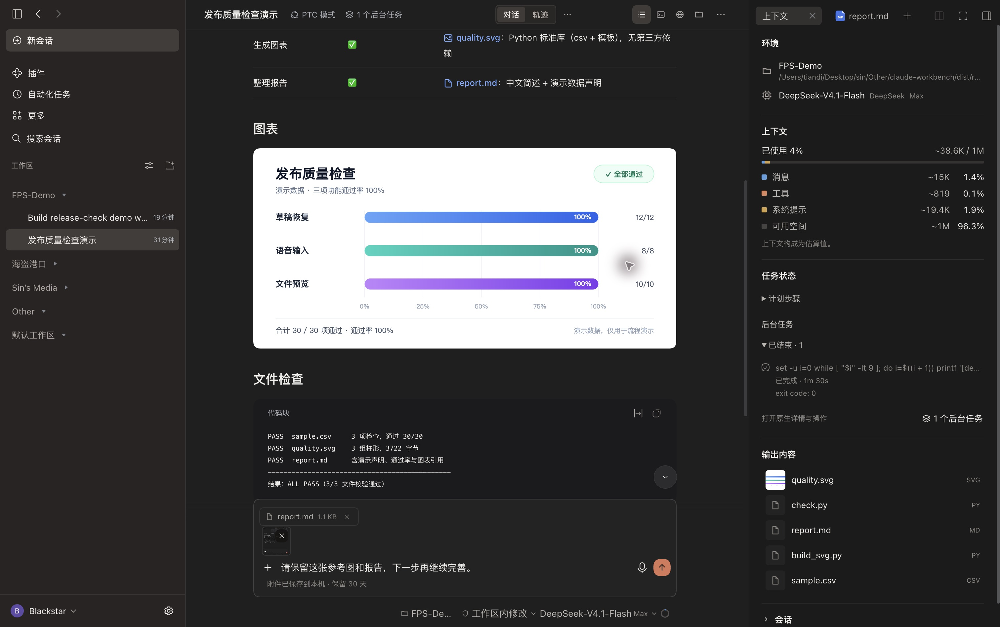
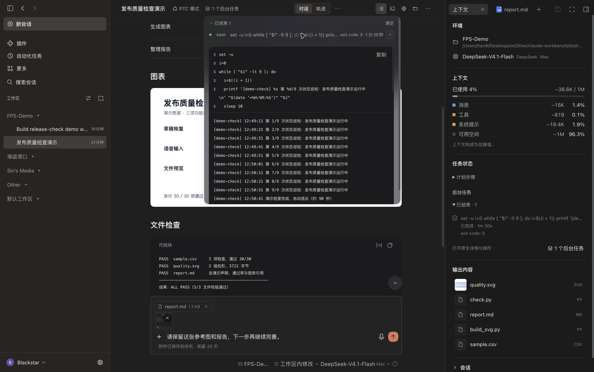
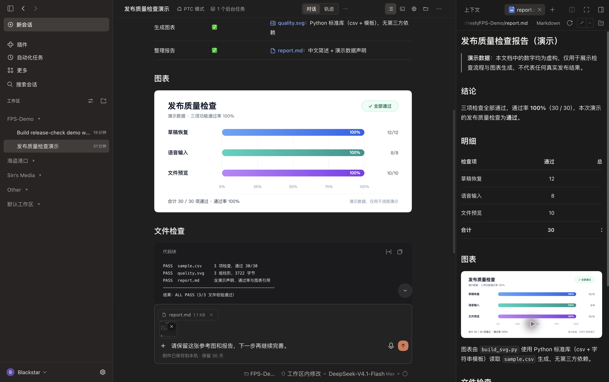
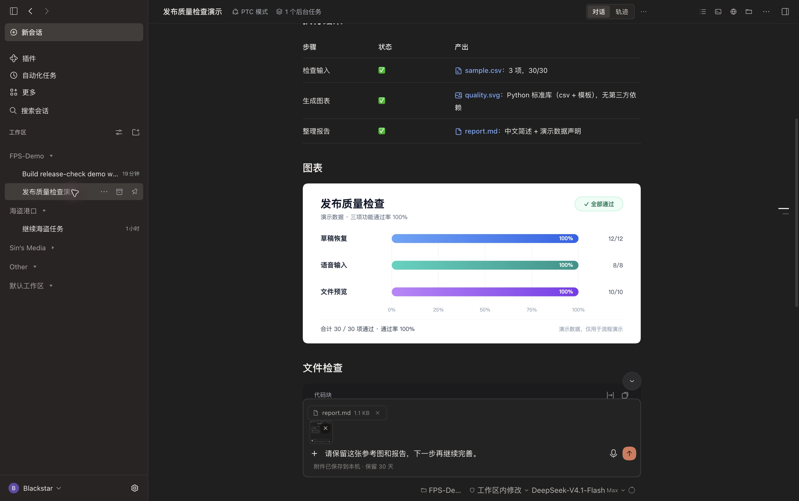
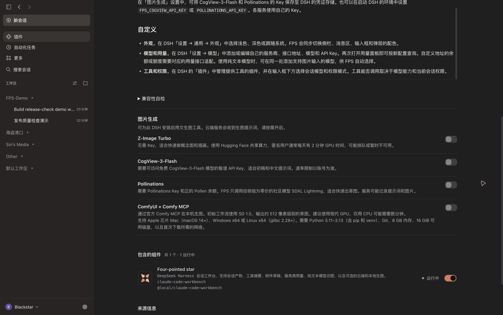
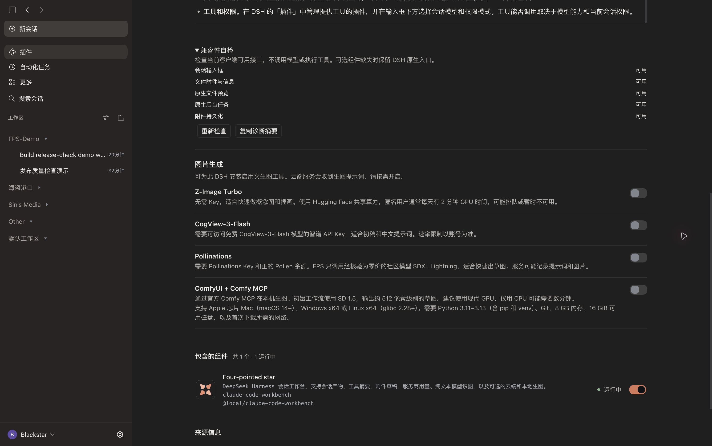

# Four-pointed star（FPS）

[GitHub 仓库](https://github.com/Blacstar7/dsh-fps-workbench) · [插件目录收录页](https://awesome-dsh-plugin.com/p/Blacstar7/dsh-fps-workbench/) · [更新日志](https://github.com/Blacstar7/dsh-fps-workbench/blob/main/CHANGELOG.md) · [npm](https://www.npmjs.com/package/dsh-fps-workbench)

**看清进度，留住草稿，找到产物。**

[English](README.md) · [安装](#安装) · [更新日志](CHANGELOG.md) · [详细指南](locale/detail.zh.md)

FPS 是 **DeepSeek Harness（DSH）** 的会话工作台。它把工具摘要、长任务状态、会话产物、可恢复的附件草稿和服务商用量放进同一套界面，让你从下达指令到拿到文件，都能看清智能体在做什么。浅色与深色模式保持简洁，重点留给正在进行的工作。

会话、工具执行、权限、语音转写和文件预览继续由 DSH 原生系统负责。FPS 整理这些信息，并补上日常使用中需要的功能。



> 截图均为 DSH 桌面端深色模式全屏实拍，展开左侧栏，使用独立演示工作区和用于验证 v0.1.79 的开发构建（本机包标签可能显示旧版本号）。本页使用中文界面和中文演示内容；英文 README 另配英文截图。图中的质量检查结果为演示数据，不是产品测试成绩。

## FPS 能帮你做什么

| 使用场景 | FPS 提供的帮助 |
| --- | --- |
| 把长任务交给智能体 | 分开查看计划步骤与后台任务，了解真实状态和已用时间。 |
| 回到一段操作繁多的对话 | 一行看完读取文件、运行命令和改动文件的摘要，需要时展开原生详情。 |
| 想找到最终交付物 | 图片、报告和源码集中到「输出内容」，点击进入原生预览。 |
| 消息还没发就切换会话 | 恢复各会话的文字、图片和文件；已保存附件在重载后也能找回。 |
| 同时使用多个服务商 | 自动读取支持的余额、花费与额度，不依赖作者个人的厂商组合。 |
| 更新 DSH 后需要排查 | 查看接口兼容性，复制不含凭据和对话内容的诊断摘要。 |

## 安装

需要 **DSH 0.2.2-rc.1 或更新版本**，并启用桌面或 Web 会话组件。本次桌面改动在 macOS、DSH `0.2.2-rc.2` 上验证；其他宿主环境可提供的可选能力可能不同。

在「**插件 → 添加插件**」中选择 npm 仓库，输入 **`dsh-fps-workbench`**；也可运行：

```sh
dsh plugin --profile desktop add dsh-fps-workbench
```

Web 配置将 `desktop` 换成 `web`。[GitHub Releases](https://github.com/Blacstar7/dsh-fps-workbench/releases/latest) 也提供预打包的 `.tgz`。如 DSH 提示重启，请重启后使用。[更新日志](CHANGELOG.md) 区分已发布版本和尚未发布的改动。

## 长任务看得清，原生详情随时展开

点击会话顶栏的「**上下文**」，查看工作区、模型、上下文占用估算、任务状态和输出内容。

「**计划步骤**」显示 DSH 当前报告的原生计划，后续回合可能替换或清空它，并非整段会话的永久清单；「**后台任务**」显示宿主报告的状态和实际用时，已结束任务单独折叠。需要日志或停止操作时，打开原生任务控制入口。开始渲染并不意味着模型已经创建计划；DSH 没有报告进度时，FPS 不会编造完成百分比。



连续的工具操作汇总为读了几个文件、运行了几条命令、改动了哪些文件。点击摘要可展开 DSH 原生详情与工具检查器。运行时的 FPS 标志动画和 `ThinKing` 用时行帮助辨认进行中的工作，并遵循减少动态效果的系统偏好。

## 产物集中查看，不必翻找消息

「**输出内容**」汇集当前会话生成或明确链接的本地文件。图片、报告和源码都可以直接在 DSH 原生预览中打开。顶栏仍提供文件、终端、浏览器和原生会话视图入口。



上下文分项是**估算值**，不等同于服务商账单。面板展示消息、工具、系统提示和可用空间，并保留会话信息。

## 切换会话，也留得住未发送的内容

粘贴图片、添加文件，输入 `/` 查找命令，或用 `@` 引用文件与会话。每个会话保留自己的草稿。已保存的图片和文件不仅能在切回会话时恢复，**在同一客户端配置下重载后也能恢复**。



- 每条消息最多 **4 张图片，每张 8 MB**；**6 个文件，每个 20 MB**。
- 附件存入本机 IndexedDB，文字使用浏览器本地存储；属于本机恢复，不跨设备同步。
- 关闭前请等待保存完成提示。存储失败提供「**重试**」，提交失败保留草稿。
- DSH 接收消息或你手动移除附件后清除；附件连续 **30 天未修改**，在之后加载时过期。
- 加载附件存储时仍可编辑文字和使用语音。发送等待加载完成或报错，存储操作设有 10 秒超时。

启用 DSH「**语音输入**」插件后，发送按钮旁会显示麦克风。录音、转写继续使用原生实现；转写结束时，即便已经切换会话，文字也归入原会话草稿。使用前仍需配置可用的语音服务并授权麦克风。

工作区、模型、推理强度和权限控制保持 DSH 原生逻辑。会话运行中，Enter 遵循 DSH 的发送偏好，Cmd/Ctrl+Enter 使用另一种投递方式。

## 服务商能返回什么，用量面板就显示什么

点击**模型选择器旁的用量圆环**。FPS 自动识别已配置的服务商，用适用的凭据访问受支持接口，显示实际返回的 API 余额、花费、Token、剩余额度、周期限额或重置时间。

各服务商之间有分隔，按名称字母顺序排列，不区分大小写。同一厂商的独立计费接口可能分成不同区块。弹层高度上限为 720 px，同时受屏幕可用空间限制；内容超过可用高度后才滚动。

**不支持、读取失败或缺失的字段隐藏；真实返回的零值正常显示。** 会话 Token 和上下文估算与账号用量分开呈现。一些组织级接口需要额外凭据，普通模型 Key 不一定能读取所有账号指标。FPS 不会根据 Token 推算余额，也不承诺支持任意自定义地址。配置方式见[详细指南](locale/detail.zh.md)。

## 识图与生图，按自己的环境选择

### 为纯文本会话补充图片理解

所选模型不支持图片时，FPS 从用户自己的 DSH 配置中查找可识图模型，取得图片描述，再交给当前会话。没有指定必须使用哪一个模型。这可能额外发起模型请求，并产生对应服务商的费用；没有合适模型时，提示错误并保留草稿。

### 可选云端与本地生图

打开「**插件 → Four-pointed star → 图片生成**」。四项服务**默认全部关闭**，按需开启并完成配置后，模型才可调用。生成图片会进入会话产物，通过原生预览打开。



| 选项 | 配置 | 适用范围与限制 |
| --- | --- | --- |
| Z-Image Turbo | 无需 Key，使用 Hugging Face 共享 Space | 快速概念图，受共享 GPU 额度、排队和服务可用性限制。 |
| CogView-3-Flash | 使用自己的服务商 Key | Flash 档标准画质，受账号资格和速率限制影响。 |
| Pollinations | 使用自己的 API Key | 实时目录标价为零时调用 SDXL Lightning 做草图；仍可能要求账号有正余额。 |
| ComfyUI + 官方 Comfy MCP | 开启后，主动点击下载与安装 | 本地 SD 1.5 工作流，约 512 像素草图；安装需 Git、兼容 Python、网络和至少 16 GiB 可用磁盘。 |

开启 ComfyUI **不会立即下载**。安装可查看进度和取消，关闭开关保留已下载文件。Apple 芯片 Mac 本地出图已经实测；Windows、Linux 安装尚未实机验证。云端服务会收到提示词并适用各自政策，免费档和可用性也可能改变，不承诺无限或永久免费。

完整要求、凭据配置与画质预期见[生图指南](locale/detail.zh.md#可选生图工具)。FPS 尽量优先使用已有生图工具；请求失败后不会悄悄切换其他服务。

## 更新后，先看看哪些接口可用

打开「**插件 → Four-pointed star → 兼容性自检**」，检查输入框、文件、预览、后台任务和本机草稿存储接口。可以重新检查，或复制不含 Key、路径和对话内容的诊断摘要。



这是一项**接口能力检查**，不是模型推理或工具调用可靠性测试。输入框契约缺失或 FPS 输入框渲染失败时，本次页面会回退到 DSH 原生输入框。语音和后台任务等可选集成分别隔离，缺少某项能力不会让整个工作台失效。

## 按自己的习惯配置

| 想调整什么 | 在哪里设置 |
| --- | --- |
| 浅色、深色、跟随系统，以及界面语言 | DSH「**设置 → 通用设置**」，FPS 跟随宿主。 |
| 服务商、地址、Key 和模型能力 | DSH「**设置 → 模型**」；用量需要对应接口支持，识图回退需要配置可识图模型。 |
| 工具与语音输入 | DSH「**插件**」，开启需要的原生组件。 |
| 当前会话模型、权限和推理强度 | 输入框底栏；执行和审批仍由 DSH 管理。 |
| 可选生图工具与兼容性诊断 | 「**插件 → Four-pointed star**」。 |

左栏保留原生工作区、搜索、设置和会话操作；前进、后退可回到当前窗口访问过的会话。FPS 不保证任意模型都能调用所有工具：模型能力、服务商协议、已安装工具和 DSH 权限共同决定实际可执行的操作。

## 从旧版更新

已经安装 **`dsh-fps-workbench`** 的用户，更新同一个包即可，不要再并排装第二份。

**v0.1.76 或更早版本**若使用 `@local/claude-code-workbench`，请先保存未发送附件，卸载旧条目，再在**同一 DSH 配置**安装 `dsh-fps-workbench`。生图设置、凭据、本地用量配置、会话和工作区继续沿用；同一客户端配置中的文字草稿也可保留。旧版本仅在内存保留附件，新版持久化无法找回此前重载时已经丢失的附件。

### 已知宿主问题

DSH 桌面端升级到 `0.2.2-rc.2` 后，旧 Computer Use 安装可能继续加载 `0.2.2-rc.1` 的存储依赖，导致会话和自动化任务无法加载，FPS 开启或关闭时都可能发生。请先备份受影响配置，再核实具体旧依赖后处理，使 DSH 加载当前版本内置组件。这与 FPS 的界面兼容性检查是不同层面的问题。

## 开发与许可

仓库包含命令、会话导航、产物、附件存储、长任务集成、用量解析和生图工具的测试。使用当前 Node.js 运行时执行：

```sh
node --test tests/*.test.mjs
```

采用 [MIT 许可证](LICENSE)。[源码与版本发布](https://github.com/Blacstar7/dsh-fps-workbench)。
