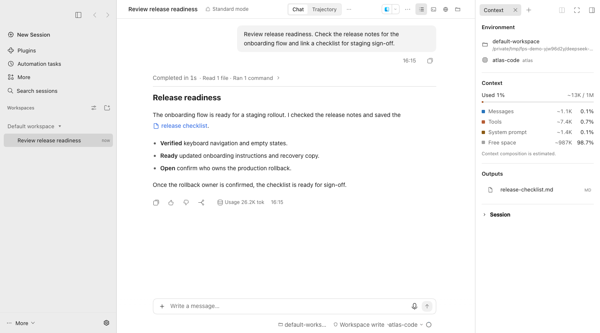
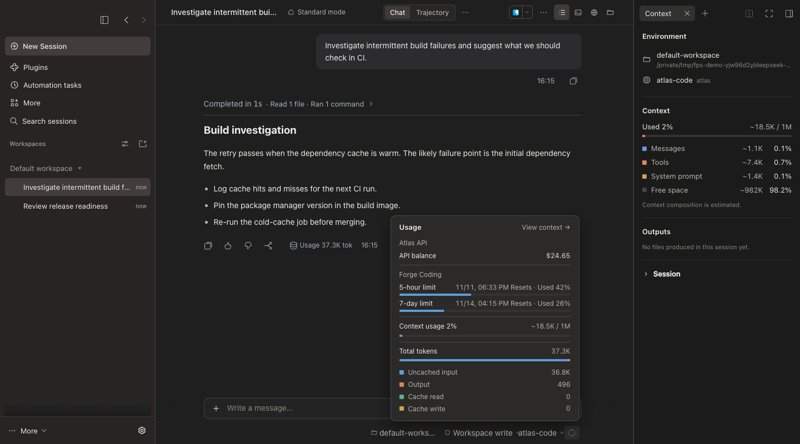
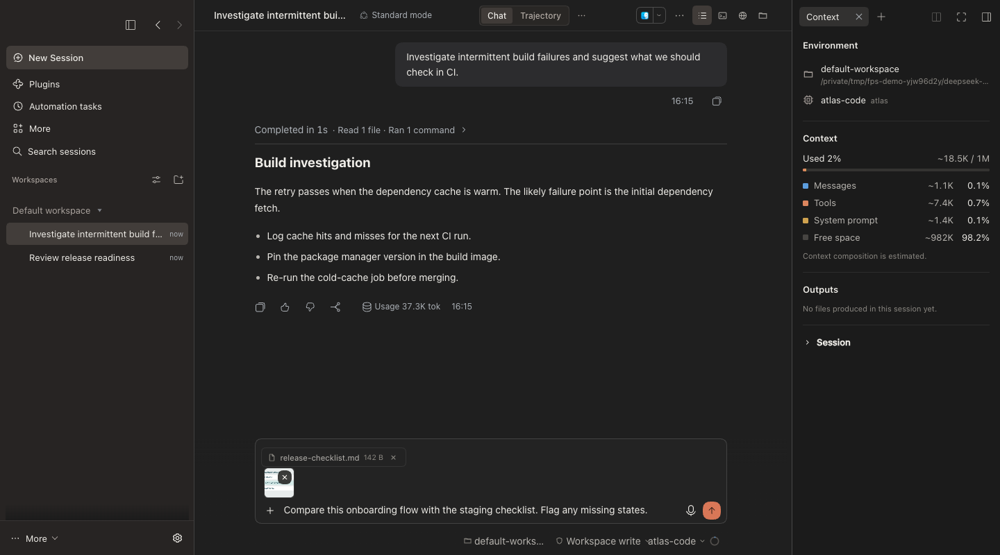
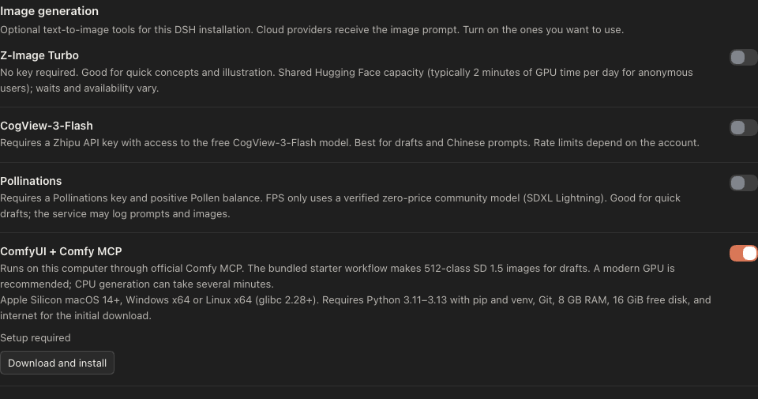

# Four-pointed star（FPS）

[English](README.md) · [更新日志](CHANGELOG.md)

FPS 是 DeepSeek Harness（DSH）的会话工作台。你可以在同一处跟踪工具进度、打开会话产物、查看上下文与服务商用量。切换会话后可以找回未发送的附件；使用纯文本模型时可借助已配置的视觉模型读图，也可按需开启云端或本地生图。

## 界面截图

以下截图使用英文界面和模拟任务数据。

浅色模式下，会话中显示报告任务的工具进度，生成的文件可在「输出内容」中打开。



深色模式下的上下文侧栏与用量弹窗。图中的余额和额度为演示数据。



切换会话再返回后，未发送的文字、图片和文件一同恢复。



## 主要功能

- **上下文与会话产物**。点会话顶栏的「上下文」按钮，查看模型、会话状态和上下文占用估算。「输出内容」汇集会话生成或明确链接的本地文件，点击后用 DSH 原生预览打开。顶栏也可切换文件、终端和浏览器。
- **工具步骤摘要**。连续的读文件、执行命令和编辑操作会汇总成一行，展开可查看 DSH 原生详情。任务列表区分已完成、进行中和待处理。会话运行时，`ThinKing` 显示用时和 FPS 标志动画，遵循系统的减少动态效果设置。
- **输入与附件草稿**。支持粘贴图片，也可从「添加」菜单选择图片和文件。切换会话再回来时，会恢复该会话的文字草稿和未发送的附件。重新加载或关闭界面会清除未发送的附件。每条消息最多可添加 4 张各 8 MB 的图片和 6 个各 20 MB 的文件。
- **纯文本模型识图**。如果所选模型不支持图片输入，FPS 会从 DSH 的可用模型中查找支持图片的模型，将图片和问题发给它，再把生成的描述交给当前会话。找不到可用模型时，输入框会保留草稿并提示失败。
- **会话和工作区**。左栏保留 DSH 的原生工作区、会话搜索和设置。侧栏按钮旁的前进、后退箭头可在本次打开窗口后访问过的会话间切换。
- **命令、引用和语音**。输入 `/` 查找命令，输入 `@` 引用文件或会话。输入框下方可选择工作区、权限、模型和推理强度，也可查看用量。在 DSH「插件」中启用「语音输入」，发送按钮旁会出现麦克风。尚未准备语音模型时，点麦克风会打开设置引导。

FPS 通过 DSH 原生会话发送消息。模型可以使用当前配置已启用的工具，由 DSH 按会话权限执行或请求确认。

## 用量怎么显示

点模型选择器旁的圆环。FPS 根据 DSH 中已启用的服务商及其 API Key 查询用量，按适配接口实际返回的内容显示余额、已用金额、额度或重置时间。零余额正常显示。接口未适配、查询失败或缺少数据时，相应账户或字段会自动隐藏。会话 Token 和上下文占用估算由 DSH 提供，单独显示。

## 可选生图工具

在「插件 → Four-pointed star → 图片生成」中按需开启，四项开关默认关闭。你可以在提示词中指定服务，也可以让 FPS 从已开启、已就绪的服务中选择。生成的图片进入会话「输出内容」，可用 DSH 原生预览打开。云端服务会接收生图提示词。

图中开启 ComfyUI 是为了展示下载入口。只有点「下载并安装」才会开始安装。



- **Z-Image Turbo**。无需 API Key。使用 Hugging Face 的共享 Space，适合快速试稿，受排队与每日 GPU 额度限制。
- **CogView-3-Flash**。智谱免费 Flash 模型，适合常规画质需求。需要智谱开放平台 API Key，受服务限流约束。
- **Pollinations**。需要自己的 API Key。FPS 在实时目录标价为零时使用 SDXL Lightning 快速打样，服务仍可能要求账户有正的可用余额。
- **ComfyUI + Comfy MCP**。通过 ComfyUI 和官方 Comfy MCP 在本机生图。开启后手动启动下载。随附的 SD 1.5 工作流适合约 512 像素的草图，安装需要 Python、Git、网络连接和 16 GiB 可用磁盘空间。

安装步骤、凭证设置、平台要求和画质说明见插件详情。[图片生成说明](locale/detail.zh.md#可选生图工具)

## 自定义

- **外观**。在 DSH「设置 → 通用 → 外观」中选择浅色、深色或跟随系统。FPS 会同步切换侧栏、消息区、输入框和弹层的配色。
- **模型和用量**。在 DSH「设置 → 模型」中添加或编辑自己的服务商、接口地址、模型和 API Key。再次打开用量面板即可按新配置查询。自定义地址的余额或额度需要对应的用量接口适配。使用纯文本模型时，可在同一处添加支持图片输入的模型，供 FPS 自动选择。
- **工具和权限**。在 DSH 的「插件」中管理提供工具的插件，并在输入框下方选择会话模型和权限模式。工具能否调用取决于模型能力和当前会话权限。

## 安装

使用 DSH 0.2.2-rc.1 或更新版本的桌面端或 Web 会话界面。语音输入和文件预览等功能需要当前 DSH 配置启用相应组件。

在 DSH「插件 → 添加插件」中选择 npm 仓库，输入 `dsh-fps-workbench`。也可从 [GitHub 最新版本](https://github.com/Blacstar7/dsh-fps-workbench/releases/latest)下载 `.tgz` 安装包，再选择本地路径安装。已安装 DSH 命令行时也可运行以下命令。

```sh
dsh plugin --profile desktop add dsh-fps-workbench
```

Web 配置将 `desktop` 换成 `web`。按 DSH 提示重启。

### 从 v0.1.76 或更早版本换装

先保存未发送的附件。在「插件 → 已安装」卸载包名为 `@local/claude-code-workbench` 的旧版 Four-pointed star，再在同一个 DSH 配置中安装 `dsh-fps-workbench`，按提示重启。新版会读取已有的生图开关、已保存的凭证和本地用量配置。DSH 会话和工作区保存在原配置里，同一浏览器或桌面配置中的文字草稿也可继续使用。未发送的附件只保存在页面内存中，重新加载会清除。

### 已知问题

**DSH 桌面端升级到 `0.2.2-rc.2` 后，会话和自动化任务可能无法加载。** 如果桌面配置仍加载旧版电脑操作组件带入的 `0.2.2-rc.1` 存储依赖，无论 FPS 是否开启，都可能遇到这个问题。请先备份桌面配置，将旧版电脑操作组件及其存储依赖移出配置的依赖目录，再重启 DSH，让它加载当前版本自带的组件。

## 许可证

FPS 采用 [MIT 许可证](LICENSE)。
